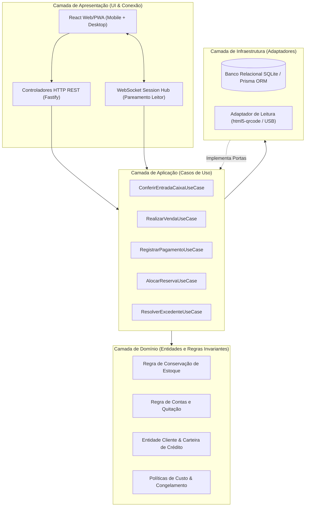
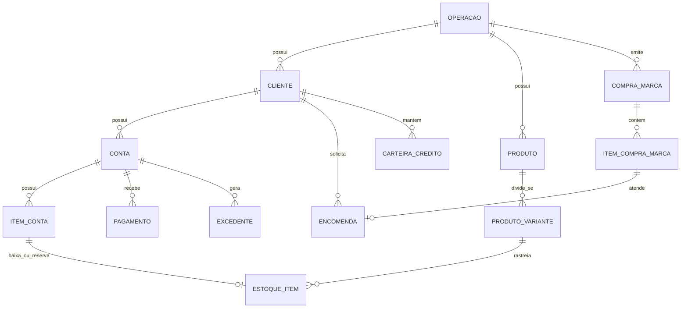

# Architecture Spine — ConsultoraSync (Primeiro Teste T1)

Este documento estabelece as decisões arquiteturais invariantes, regras de fronteira e modelos estruturais que governam o desenvolvimento do Primeiro Teste Funcional (T1) do ConsultoraSync. Ele atua como contrato técnico normativo para impedir divergências de implementação.

---

## Design Paradigm

O sistema adota o paradigma **Modular Monolith** estruturado em camadas limpas orientadas ao domínio (**Clean / Hexagonal Architecture**). 

Toda a lógica contábil, regras de reserva de estoque e regras de alocação residem puramente no núcleo de domínio, sem qualquer dependência direta de bancos de dados, frameworks HTTP ou bibliotecas de interface.



### Regra Estrita de Dependência:
- A camada de **Domínio** não importa nada de fora.
- A camada de **Aplicação** depende apenas do Domínio e define contratos (interfaces/portas) para a Infraestrutura.
- A **Apresentação** e a **Infraestrutura** são adaptadores externos descartáveis ou substituíveis sem afetar as regras de negócio.

---

## Invariants & Rules

### AD-1 — Isolamento Operacional e Rastreabilidade Nominal do Operador
- **Binds:** FR-001, FR-002, FR-037, NFR-002
- **Prevents:** Vazamento de dados entre diferentes revendedoras e perda de auditoria em cancelamentos/estornos.
- **Rule:** Toda tabela e registro de dados possui obrigatoriamente a coluna `operacao_id`. Nenhuma consulta retorna dados de outra operação, mesmo sob fornecimento direto de identificadores. Toda movimentação financeira e estorno registra o `operador_nome` e `operador_id` da pessoa autenticada na sessão ativa (revendedora ou familiar autorizado).

### AD-2 — Imutabilidade de Custo Histórico e Preservação de Custo Desconhecido
- **Binds:** FR-011, FR-012, CF-03, CF-04
- **Prevents:** Recálculo retroativo de custos em vendas passadas e assunção incorreta de custo zero para itens sem percentual.
- **Rule:** Ao confirmar uma transação, o `custo_unitario` e a `origem_custo` (`ESTIMADO_PERCENTUAL`, `INFORMADO` ou `DESCONHECIDO`) são gravados de forma imutável na linha da transação. Se o produto não tiver custo nem percentual cadastrado, o valor é armazenado como `NULL` e o status como `DESCONHECIDO`; o sistema é proibido de gravar 0,00 ou calcular margem artificial sobre esse item.

### AD-3 — Conservação Estrita de Estoque Físico e Reserva Lógica
- **Binds:** FR-013, FR-020 a FR-028, CT-10 a CT-13
- **Prevents:** Saída física dupla e divergência entre contagem de armário e saldo em tela.
- **Rule:** O estoque físico satisfaz a invariante:
  $$\text{Presentes} = \text{Reservados} + \text{ProntaEntrega}$$
  - A entrada física ocorre na confirmação da conferência da caixa (`presentes++`).
  - A alocação para uma encomenda de cliente cria reserva nominal (`reservados++`, `pronta_entrega` inalterada), sem subtrair do total de frascos presentes.
  - A saída física só é debitada no ato da confirmação de entrega ao cliente (`presentes--`, `reservados--`).
  - O sistema impede a redução de itens presentes abaixo do número de reservas ativas sem a resolução prévia das encomendas vinculadas.

### AD-4 — Conta Individual por Compra e Projeção da "Visão Sem Aguardados"
- **Binds:** FR-032 a FR-036, CT-15, CT-16
- **Prevents:** Mistura indevida de pagamentos entre compras distintas e cobrança antecipada forçada de produtos que a marca ainda não entregou.
- **Rule:** Cada transação gera um registro de conta (`ContaCliente`) próprio. Pagamentos parciais são aplicados à conta explicitamente selecionada. A "Visão Sem Itens Aguardados" não cria uma nova conta contábil: ela é uma **projeção calculada em tempo de consulta** que subtrai do total da conta o valor de itens cujo status de entrega seja `AGUARDANDO_FABRICA`.

### AD-5 — Excedente Financeiro como Estado Transitório e Crédito Intransferível
- **Binds:** FR-038 a FR-041, CF-05, CT-19, CT-20
- **Prevents:** Dinheiro sumido em cancelamentos de itens quitados e transferência de crédito entre clientes diferentes.
- **Rule:** O cancelamento de item reduz o `valor_total` da conta. Caso `total_pago > novo_total`, a diferença é registrada imediatamente como `excedente_pendente`. Esse valor exige resolução explícita obrigatória: ou `DEVOLUCAO_DINHEIRO` (baixa definitiva) ou `CONVERSAO_CREDITO` (adicionado à `carteira_credito` daquele cliente específico). Créditos de um cliente jamais podem ser aplicados em compras de outros clientes.

### AD-6 — Pareamento Efêmero Celular-Computador com Expiração e Sem Login Exposto
- **Binds:** FR-014, CT-08
- **Prevents:** Exposição de dados de clientes no pareamento e conexão indevida de aparelhos não autorizados.
- **Rule:** O computador gera um `session_token` criptográfico aleatório (TTL de 10 minutos) e exibe um QR Code com a URL `https://.../leitor?t=<token>`. O celular conecta a um canal WebSocket efêmero associado a esse token e envia exclusivamente mensagens do tipo `{ event: 'SCAN', code: '789...' }`. A página do leitor no celular não tem acesso à lista de clientes ou histórico financeiro, operando unicamente como transmissor de bipagem.

### AD-7 — Idempotência e Prevenção de Duplicação em Queda de Rede
- **Binds:** NFR-001, FR-020, FR-026, FR-034, CT-21
- **Prevents:** Duplicação de entradas de estoque, saídas de venda ou recebimentos em caso de reconexão Wi-Fi/4G.
- **Rule:** Toda requisição de mutação (`POST /conferencia`, `POST /vendas`, `POST /pagamentos`) deve incluir um `idempotency_key` (UUID v4) gerado na interface do cliente antes do envio. Em caso de repetição da mesma chave, o servidor responde com a resposta prévia sem reprocessar as alterações de saldo ou estoque.

### AD-8 — Arquitetura Full-Stack TypeScript de Custo Zero e Operação Local-First
- **Binds:** NFR-004, NFR-007, Requisito de Custo Zero do TCC
- **Prevents:** Dependência de infraestrutura paga na nuvem ou falhas de internet durante bancas e testes presenciais.
- **Rule:** Todo o ecossistema T1 é construído em TypeScript ponta a ponta (Node.js/Fastify no backend e React/Vite no frontend). O armazenamento utiliza **SQLite** via ORM Prisma, permitindo que a aplicação rode com zero dependências externas em qualquer computador comum, conectando o celular pela rede Wi-Fi local. A mesma estrutura é 100% compatível com PostgreSQL no Supabase para publicação em nuvem.

---

## Consistency Conventions

| Preocupação | Convenção Padrão |
|---|---|
| **Identificadores Únicos** | `UUID v7` (ordenável por tempo, eliminando necessidade de auto-incremento sequencial exposto). |
| **Moeda e Valores Monetários** | Armazenamento de valores em **centavos inteiros** (`INTEGER`, ex: R$ 50,00 → `5000`) para evitar erros de ponto flutuante em arredondamentos de taxas de cartão. |
| **Datas e Timestamps** | Formato ISO-8601 UTC (`YYYY-MM-DDTHH:mm:ss.sssZ`). |
| **Nomenclatura no Código** | `camelCase` para propriedades TypeScript, `snake_case` para tabelas/colunas de banco, e `kebab-case` para nomes de arquivos e rotas de API. |
| **Respostas de Erro da API** | Padrão RFC 7807: `{ "type": "https://consultorasync.app/errors/:tipo", "title": "...", "status": 400, "detail": "...", "code": "ESTOQUE_INSUFICIENTE" }`. |

---

## Stack Tecnológica Paginada (Seed)

| Tecnologia | Versão Pinned | Papel no Sistema |
|---|---|---|
| **Node.js** | `20 LTS / 22 LTS` | Ambiente de execução do servidor backend. |
| **TypeScript** | `5.7+` | Tipagem estática rigorosa ponta a ponta. |
| **Fastify** | `5.1+` | Framework HTTP leve, rápido e com baixo consumo de memória. |
| **ws / @fastify/websocket** | `8.18+` | Hub de WebSockets para pareamento do leitor em tempo real. |
| **Prisma ORM** | `6.0+` | Modelagem, migrações e tipagem automática do banco de dados. |
| **SQLite (better-sqlite3)** | `11.x` | Banco de dados local de alta velocidade para o Primeiro Teste T1. |
| **React** | `19.0+` | Biblioteca de interface web do frontend. |
| **Vite** | `6.0+` | Bundler e servidor de desenvolvimento frontend ultrarrápido. |
| **Tailwind CSS** | `3.4+ / 4.0` | Estilização por classes utilitárias sincronizada com `DESIGN.md`. |
| **html5-qrcode** | `2.3.8+` | Biblioteca para decodificação em tempo real de código de barras pela câmera. |
| **Vitest** | `2.1+` | Framework de testes unitários e de integração de execução instantânea. |

---

## Structural Seed

### 1. Modelo de Entidades e Relacionamentos (ERD)



### 2. Árvore de Diretórios do Projeto (Monorepo Enxuto)

```text
prototipo_TCC/
├── packages/
│   ├── core/                    # Regras de Domínio e Tipos Compartilhados
│   │   ├── src/
│   │   │   ├── domain/          # Entidades (Estoque, Conta, Cliente, Produto)
│   │   │   └── value-objects/   # Centavos, CodigoBarras, StatusEstoque
│   │   └── package.json
│   ├── server/                  # Backend Fastify + WebSockets + Prisma
│   │   ├── src/
│   │   │   ├── application/     # Casos de Uso (Conferencia, Venda, Pagamento)
│   │   │   ├── infrastructure/  # Repositórios Prisma, SQLite, WebSocket Hub
│   │   │   └── routes/          # Endpoints HTTP da API
│   │   ├── prisma/
│   │   │   └── schema.prisma    # Definição das tabelas e migrações
│   │   └── package.json
│   └── web/                     # Frontend React + Vite + PWA
│       ├── src/
│       │   ├── components/      # Botões 48px, Visor de Câmera, Cards de Estoque
│       │   ├── pages/           # Início, Conferência, Venda, Clientes, Leitor
│       │   └── hooks/           # useScanner, useWebSocketSession, useOfflineSync
│       └── package.json
└── docs/                        # Documentação técnica e textos para o TCC
```

---

## Capability → Architecture Map

| Capacidade (Requisito T1) | Módulo Responsável | Invariante / Regra de Controle |
|---|---|---|
| **Acesso e Isolamento (FR-001, FR-002)** | `server/routes/auth` & `core/domain` | **AD-1**: Filtro automático de `operacao_id` em todos os repositórios. |
| **Cadastro de Clientes e Ficha (FR-003, FR-004)** | `packages/core` & `server/application` | **AD-1**: Ficha com visão separada de contas e encomendas. |
| **Produtos, Códigos e Variantes (FR-006 a FR-010)** | `packages/core` & `web/components/Scanner` | **AD-2**: Variantes com códigos independentes e buscas por nome/EAN. |
| **Custo Estimado vs Desconhecido (FR-011, FR-012)** | `packages/core/domain` | **AD-2**: Gravação imutável; preservação de `NULL` para desconhecido. |
| **Estoque Inicial e Contagem (FR-013)** | `server/application/Estoque` | **AD-3**: Criação de lote inicial próprio sem compra fictícia à marca. |
| **Leitor Pareado via Celular (FR-014)** | `server/infrastructure/ws` | **AD-6**: Canal WebSocket com QR Code e token temporário. |
| **Encomendas e Pedido à Marca (FR-015 a FR-019)** | `server/application/CompraMarca` | **AD-3**: Agrupamento de itens de clientes e pronta-entrega. |
| **Conferência e Destinação (FR-020 a FR-025)** | `server/application/Conferencia` | **AD-3**: `presentes++` e pergunta mandatória de reserva vs pronta-entrega. |
| **Venda, Reserva e Entrega (FR-026 a FR-031)** | `server/application/Venda` | **AD-3**: Baixa de presentes apenas no momento da entrega confirmada. |
| **Contas e Visão sem Aguardados (FR-032 a FR-036)** | `server/application/Conta` | **AD-4**: Projeção em tempo de consulta excluindo itens aguardados. |
| **Estorno com Identificação (FR-037)** | `server/application/Pagamento` | **AD-1**: Estorno grava `operador_id` e justifica a reversão. |
| **Excedente, Devolução e Crédito (FR-038 a FR-041)** | `server/application/Excedente` | **AD-5**: Resolução explícita em devolução ou crédito na carteira. |
| **Idempotência e Concorrência (NFR-001)** | `server/infrastructure/http` | **AD-7**: Bloqueio de requisições duplicadas via `idempotency_key`. |

---

## Deferred (Pós-T1 / Fases Futuras)

1. **Relatório Completo de Ganhos P2 e Boletos (FR-042 a FR-051)**: Ficam para a segunda fase do projeto após a validação do fluxo operacional T1.
2. **Integrações Externas Automáticas (FR-052 a FR-055)**: A consulta à Open Beauty Facts ou APIs das marcas é opcional e isolada; falhas externas não impactam a operação manual.
3. **OCR de DANFE / Nota Fiscal em PDF/XML**: Previsto para a Fase 2 do roadmap evolutivo.
4. **Persistência Distribuída Multi-Região**: O primeiro teste opera perfeitamente com banco SQLite local ou Supabase camada gratuita.
