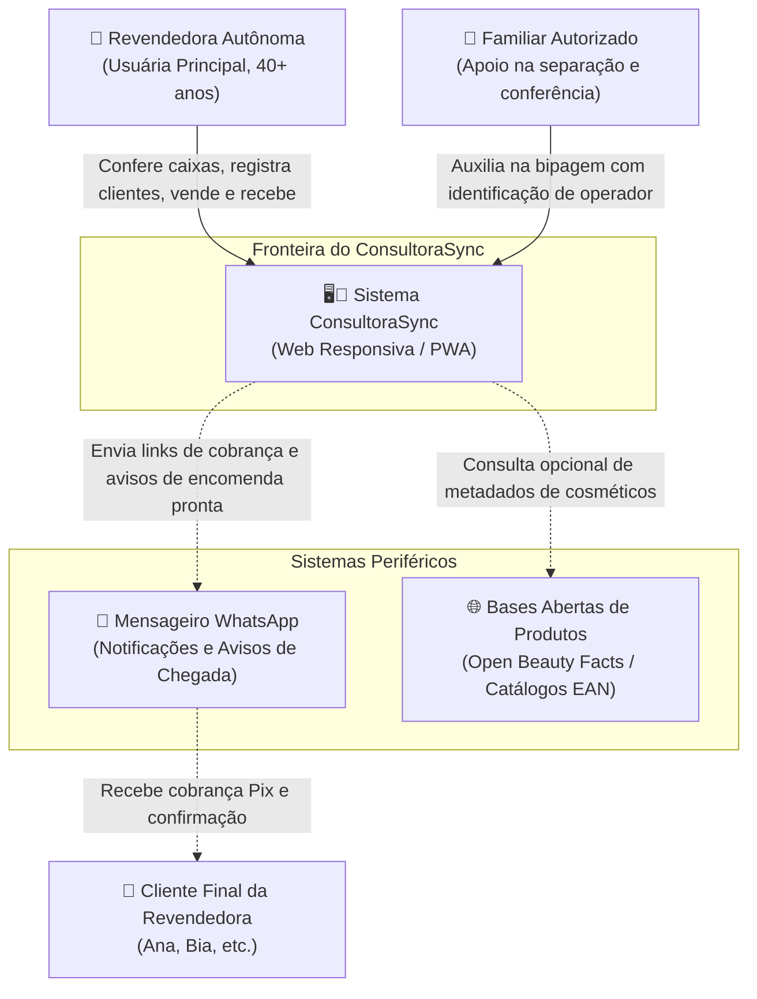
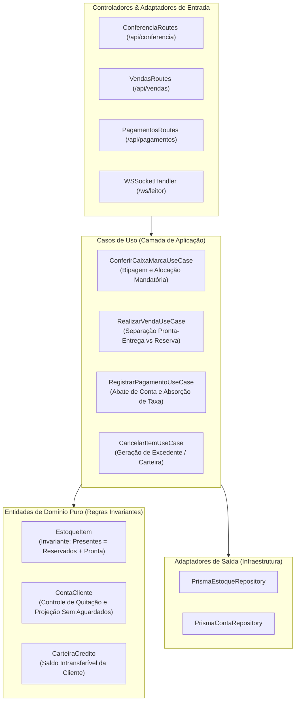
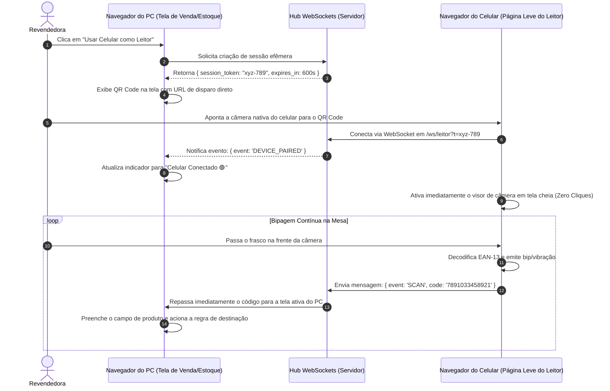

# Projeto Arquitetural e Design de Solução — ConsultoraSync
**Documento Técnico-Acadêmico para Apoio ao Trabalho de Conclusão de Curso (TCC)**

- **Autor:** Duda  
- **Data:** 10 de Novembro de 2026  
- **Projeto:** ConsultoraSync — Sistema de Apoio Operacional para Revendedoras de Venda Direta  
- **Documento Complementar ao:** [ARCHITECTURE-SPINE.md](ARCHITECTURE-SPINE.md)

---

## 1. Contexto, Problema e Motivação Acadêmica

O modelo de venda direta e revenda por catálogo de cosméticos (representado por gigantes como Natura, Avon e O Boticário) movimenta bilhões de reais anualmente no Brasil e constitui uma das principais fontes de renda autônoma para milhões de famílias brasileiras, com forte concentração feminina e faixa etária predominante acima de 40 anos.

Apesar de sua relevância socioeconômica, a operação cotidiana dessas microempreendedoras ainda é caracterizada por ferramentas rudimentares: cadernos de papel ("fiado"), mensagens dispersas no WhatsApp e cálculos manuais de margens de lucro. Os principais problemas identificados na literatura e na prática de campo incluem:

1. **O "Buraco Negro" entre Pedido e Chegada**: A revendedora faz o pedido agrupado na marca para diversas clientes; quando a caixa de produtos chega fisicamente pelos correios/transportadora, ela perde horas tentando identificar no papel de quem era cada frasco, gerando desorganização e atritos.
2. **Saída Física Dupla e Confusão de Reserva**: Itens encomendados por uma cliente são vendidos por engano na pronta-entrega para outra pessoa que pediu na hora, deixando a encomenda original desabastecida.
3. **Barreiras Digitais e de Usabilidade**: Softwares ERP comerciais tradicionais foram desenhados para desktops corporativos com jargões contábeis incompreensíveis ("SKU", "Partida Dobrada", "MDR"), resultando em altas taxas de abandono por usuárias com pouca intimidade tecnológica ou visão cansada.
4. **Inviabilidade Financeira de Softwares Proprietários**: Soluções que exigem mensalidades recorrentes ou infraestrutura de nuvem paga excluem a base da pirâmide dessas revendedoras.

O **ConsultoraSync** foi projetado para resolver essa lacuna mediante uma arquitetura de software limpa, de custo zero de infraestrutura e com uma experiência do usuário rigorosamente calibrada para acessibilidade e agilidade operacional.

---

## 2. Visão Arquitetural em Modelo C4

Para documentar os múltiplos níveis de abstração do sistema com rigor acadêmico, adota-se o modelo **C4** (Contexto, Contêineres, Componentes e Código), proposto por Simon Brown.

### 2.1 C4 — Nível 1: Diagrama de Contexto de Sistema

O diagrama de contexto posiciona o ConsultoraSync em relação aos atores humanos e sistemas periféricos que compõem o ecossistema de revenda direta.



---

### 2.2 C4 — Nível 2: Diagrama de Contêineres

O diagrama de contêineres detalha como o sistema é particionado entre frontend, servidor de aplicação, protocolo em tempo real e camada de persistência de dados.

```mermaid
flowchart TB
    subgraph ClienteDevice["Ambiente do Usuário"]
        PWA["📱 Frontend Web Responsivo (PWA)\n[React 19, Vite, Tailwind CSS]\nInterface mobile-first com visor de câmera\npara leitura de código de barras (html5-qrcode)"]
        PCBrowser["💻 Navegador Desktop (Opcional)\n[React 19]\nPainel operacional ampliado para uso no computador"]
    end

    subgraph Servidor["Contêiner Backend (Node.js LTS)"]
        API["⚙️ Servidor de Aplicação HTTP REST\n[Fastify 5, TypeScript]\nExecução de casos de uso e regras de negócio"]
        WSHub["⚡ Hub de Comunicação em Tempo Real\n[@fastify/websocket]\nGerencia o pareamento instantâneo de bipagem celular-computador"]
    end

    subgraph Persistencia["Armazenamento de Dados"]
        DB[("💾 Banco de Dados Relacional\n[SQLite via Prisma ORM / PostgreSQL Supabase]\nIsolamento por operacao_id e transações ACID")]
    end

    PWA -->|HTTPS / REST API| API
    PCBrowser -->|HTTPS / REST API| API
    PWA <-->|WebSockets (Canal de Bipagem Efêmero)| WSHub
    PCBrowser <-->|WebSockets (Recebe Códigos Bipados)| WSHub
    API -->|Consultas e Mutações Tipadas| DB
```

---

### 2.3 C4 — Nível 3: Diagrama de Componentes da Aplicação (Clean Architecture)

A organização interna do backend segue estritamente os princípios da **Arquitetura Limpa (Clean Architecture / Hexagonal)**, isolando regras de negócio centrais de bibliotecas de terceiros:



---

## 3. Protocolo de Comunicação em Tempo Real: O Leitor Pareado (*Companion Scanner*)

Um dos principais diferenciais técnicos desenvolvidos para o primeiro teste é o **pareamento sem fio de alta velocidade** entre o celular da revendedora e o computador de mesa, permitindo que a câmera do smartphone atue como um leitor de código de barras profissional sem fios, sem necessidade de aquisição de equipamentos dedicados.

### 3.1 Diagrama de Sequência do Pareamento e Bipagem



### 3.2 Vantagens da Abordagem:
- **Segurança e Privacidade**: O celular pareado não recebe nenhum dado sensível de clientes, contas ou histórico de faturamento; ele atua puramente como dispositivo periférico de entrada.
- **Zero Instalação**: Opera 100% sobre APIs nativas da web (`navigator.mediaDevices.getUserMedia` e `WebSocket`), dispensando a compilação e publicação de APKs em lojas de aplicativos.
- **Desconexão Segura**: Ao expirar a sessão ou fechar a aba no computador, o canal é imediatamente encerrado, impedindo que eventos espúrios atinjam o sistema.

---

## 4. Engenharia de Integridade e Modelagem Contábil

Diferente de sistemas amadores de controle de estoque, o ConsultoraSync modela a movimentação de mercadorias com garantias formais de conservação matemática e rastreabilidade:

### 4.1 A Invariante Fundamental do Estoque
Em qualquer instante $t$, o estado de qualquer produto no sistema deve satisfazer rigorosamente:
$$\text{Estoque Presente}(t) = \text{Estoque Reservado}(t) + \text{Estoque em Pronta-Entrega}(t)$$

Onde:
1. **Entrada Física**: Ocorre na conferência da caixa recebida da fábrica. Se o produto estava aguardado, ele transita de `AGUARDANDO_FABRICA` para `PRESENTE`.
2. **Reserva Nominal**: O vínculo a uma encomenda de cliente não remove o frasco da casa da revendedora; logo, ele permanece em `PRESENTE` e incrementa `RESERVADO`. A pronta-entrega não é inflacionada.
3. **Saída Física**: Ocorre unicamente na entrega física à cliente em mãos (`PRESENTE--`, `RESERVADO--`). Essa modelagem resolve definitivamente a falha de "saída dupla".

### 4.2 Modelo de Quitação e Tratamento de Excedentes
- **Independência de Contas**: Cada compra ou encomenda gera uma conta com itens identificados, evitando a contaminação de saldos.
- **Visão Sem Itens Aguardados**: Calculada dinamicamente pela projeção:
  $$\text{Saldo Cobrável Hoje} = \text{Total da Conta} - \sum \text{Valor}(\text{Itens com Status } \text{AGUARDANDO\_FABRICA}) - \text{Total Pago}$$
- **Conservação de Dinheiro em Cancelamentos**: Se um item já pago de R$ 30,00 for cancelado porque a fábrica não entregou, o sistema não apaga o pagamento; cria-se um evento de `EXCEDENTE_PENDENTE = R$ 30,00`. Esse valor é resolvido explicitamente como devolução física ou migrado para a carteira de crédito nominal e intransferível daquela cliente.

---

## 5. Justificativa de Custo Zero e Metodologia de Testes para o TCC

### 5.1 Custo Zero de Infraestrutura
Para atender à premissa fundamental do TCC, o sistema é viável sem qualquer aporte financeiro:
- **Execução Local do Protótipo**: O backend roda em Node.js com banco SQLite embutido em arquivo único (`prisma/dev.db`). Em uma apresentação de banca ou teste com usuárias reais, o computador da estudante atua como servidor local, e o celular conecta pela mesma rede Wi-Fi comum (ou roteador 4G do smartphone).
- **Hospedagem em Nuvem Gratuita**: Para publicação online contínua, o frontend é compatível com o plano gratuito da Vercel, o backend com o plano gratuito do Render/Fly.io, e o banco com o plano gratuito do Supabase (PostgreSQL), sem necessidade de cartões internacionais.

### 5.2 Validação Empírica no TCC
A validação do projeto não depende de pesquisas subjetivas ou declarações genéricas. Ela está ancorada em:
1. **Suíte Automatizada de Testes (Vitest)**: Cobertura dos 22 cenários de teste formais (CT-01 a CT-22) especificados no [primeiro-teste.md](../prds/prd-consultorasync-2026-11-09/primeiro-teste.md), cobrindo cálculo financeiro, taxas de maquininha, concorrência e integridade de saldo.
2. **Teste Prático de Usabilidade de Campo**: Execução das tarefas com uma revendedora real e um familiar autorizado em celular real, registrando:
   - Taxa de conclusão de tarefas sem ajuda;
   - Tempo decorrido na conferência de uma caixa com 3 produtos;
   - Número de erros ou bips duplicados identificados pelo sistema.

Essa abordagem confere ao Trabalho de Conclusão de Curso um embasamento científico, técnico e metodológico robusto e verificável.
