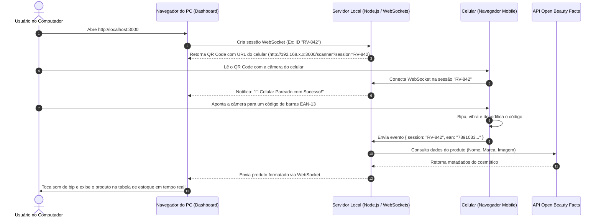

# Plano de Implementação: Protótipo da Abordagem 3 (Modo Pistola Leitora / Companion Scanner)

> **Proposta técnica original, preservada como histórico.** O experimento de pareamento continua previsto; o [briefing atual](../_bmad-output/planning-artifacts/briefs/brief-consultorasync-2026-11-09/brief.md) define o fluxo funcional completo. Busca externa, desempenho, infraestrutura e acesso à câmera exigem verificação. Este plano não é uma implementação existente.

## 1. Objetivo do Protótipo
Construir um protótipo funcional da **Abordagem 3**, permitindo que você teste o escaneamento de produtos **imediatamente no seu celular sem precisar instalar nenhum aplicativo (APK)**.

O celular funcionará como uma **pistola leitora sem fio**:
1. Você abre o sistema no navegador do seu computador.
2. A tela exibe um QR Code de conexão.
3. Você aponta a câmera do celular para esse QR Code e abre a página do leitor no navegador do celular.
4. Ao apontar a câmera do celular para qualquer produto (caixa de cosmético, perfume, alimento com código EAN-13), o celular bipa/vibra e o produto **aparece instantaneamente na tela do seu computador** com nome, marca, foto e opção de salvar no estoque.

---

## 2. Arquitetura do Protótipo



---

## 3. Componentes a Serem Criados

### 📁 Estrutura de Arquivos Proposta:
```text
/home/duda/Documentos/testeProjetos/consultorasync-prototype/
├── package.json               # Dependências: express, ws, qrcode, axios, cors
├── server.js                  # Servidor Express + WebSocket Server + Integração Open Beauty Facts
├── public/
│   ├── index.html             # Painel do Computador (Dashboard de Estoque + QR Code de Pareamento)
│   ├── scanner.html           # Tela do Celular (Câmera do Smartphone com Html5-QRCode + Feedback tátil/áudio)
│   ├── css/style.css          # Estilização moderna e responsiva (Tailwind CSS via CDN)
│   └── js/
│       ├── dashboard.js       # Lógica do PC (conexão WS, recepção em tempo real, tabela de itens)
│       └── scanner.js         # Lógica do Celular (ativação de câmera, leitura contínua, envio via WS)
```

---

## 4. Tecnologias & Custo

- **Node.js v22 & Express**: Servidor HTTP local leve e rápido.
- **WebSockets (`ws`)**: Comunicação bidirecional de latência ultrabaixa (< 50ms) entre o celular e o computador.
- **QRCode Generator**: Gera o QR Code dinâmico no servidor com o IP da sua rede local (ex: `192.168.1.X`), facilitando o pareamento em 2 segundos.
- **`html5-qrcode`**: Biblioteca open-source para captura e decodificação de código de barras pela câmera do celular sem necessidade de instalar app.
- **Open Beauty Facts API**: API aberta gratuita para buscar dados de cosméticos pelo EAN-13.
- **Custo Total**: **R$ 0,00**.

---

## 5. Plano de Verificação & Teste Prático

1. **Inicialização do Servidor**:
   - Executar `npm start` no terminal. O console exibirá o endereço local e o IP de rede.
2. **Teste no Computador**:
   - Abrir o navegador em `http://localhost:3000`.
   - Verificar se o QR Code de pareamento é renderizado com a sessão ativa.
3. **Pareamento com o Celular**:
   - No celular conectado na mesma rede Wi-Fi, ler o QR Code ou digitar o endereço IP informado.
   - O painel do computador deve mudar de estado para *"Celular Conectado"*.
4. **Escaneamento Real de Produtos**:
   - Bipar uma caixa de cosmético real (Natura, Boticário ou qualquer produto com código de barras comercial).
   - Validar se o celular emite vibração/som e se a tela do computador atualiza na hora com os dados do produto.
