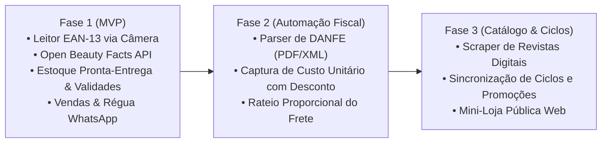
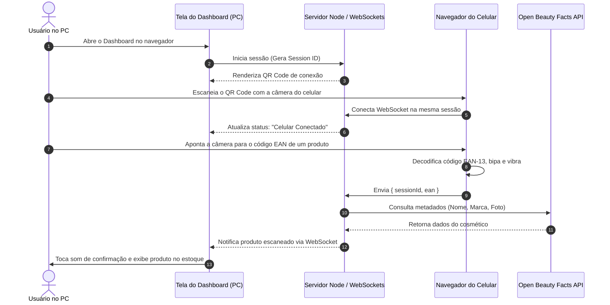
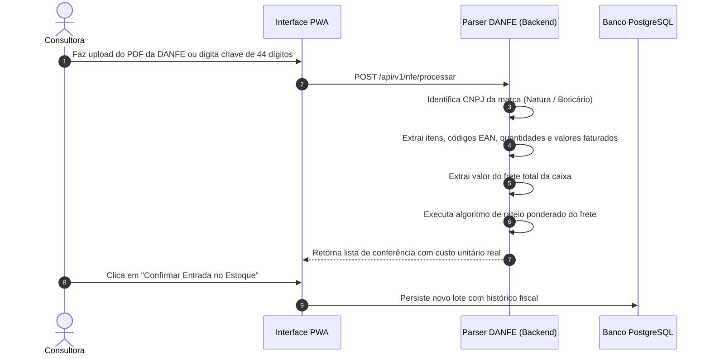
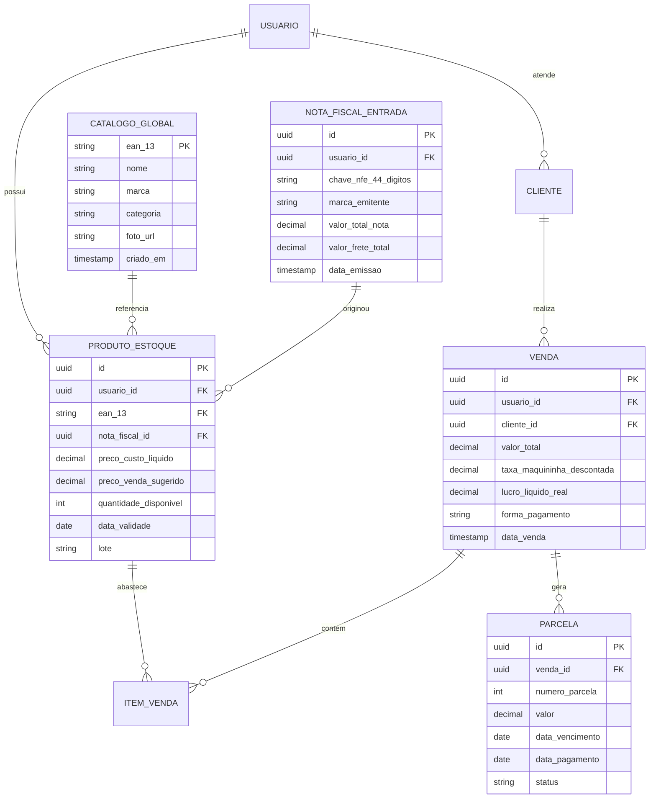

# Especificação Arquitetural e Roadmap: ConsultoraSync

> **Plano anterior — revisão pendente após a descoberta de 09/11/2026.** O [briefing atual](../_bmad-output/planning-artifacts/briefs/brief-consultorasync-2026-11-09/brief.md) define o primeiro teste de clientes, pedidos, estoque e contas/pagamentos. Tecnologias, modelo de dados, integrações, custo, desempenho e fases abaixo precisam de reconciliação antes da implementação.

## 1. Visão Geral do Sistema
O **ConsultoraSync** é um software de suporte à operação e tomada de decisão para revendedoras autônomas de venda direta e cosméticos por catálogo.

### Premissas Fundamentais:
1. **Zero Custo de Infraestrutura**: Uso exclusivo de camadas gratuitas (*free tiers*) sem necessidade de cartão internacional.
2. **Entrada de Dados Ágil**: Eliminação da digitação manual de produtos via câmera do celular (código de barras EAN-13 e Nota Fiscal/DANFE).
3. **Independência de Entrevistas em Massa**: Validação acadêmica embasada em heurísticas de usabilidade (Nielsen) e suíte de testes automatizados de cálculo financeiro.

---

## 2. Roadmap Evolutivo (3 Fases)



---

## 3. Arquitetura de Integração com o Celular

### Comparativo de Abordagens de Escaneamento

| Critério | Abordagem 1: PWA Web Puro | Abordagem 2: Híbrido com Capacitor (APK) | Abordagem 3: Companion Scanner (WebSockets) |
|---|---|---|---|
| **Como o Celular Conecta** | Acesso pelo navegador mobile (Chrome/Safari) | Aplicativo `.apk` instalado no Android | Lê QR Code na tela do PC para parear |
| **Acesso à Câmera** | `navigator.mediaDevices.getUserMedia` | Plugin Nativo Capacitor + Google ML Kit | Câmera do smartphone via WebRTC / Canvas |
| **Velocidade de Leitura** | 300ms a 600ms | < 100ms (Acelerado por hardware) | Instantânea via WebSocket |
| **Instalação** | Nenhuma (atalho de tela) | Arquivo `.apk` local | Nenhuma (navegador mobile) |
| **Papel no Projeto** | Modo alternativo web | **Versão Final de Produção** | **Fase de Testes Inicial** |

> **Decisão**: A fase de validação imediata adota a **Abordagem 3 (Companion Scanner)** para testar o escaneamento físico sem atrito de compilação. Em seguida, a solução evolui para a **Abordagem 2 (Capacitor/APK)**.

---

## 4. Diagrama de Contêineres (Modelo C4)

```mermaid
flowchart TB
    Consultora["Consultora / Revendedora\n(Celular Smartphone)"]
    Cliente["Cliente Final\n(WhatsApp)"]

    subgraph Frontend["Frontend Web & PWA (Vercel)"]
        UI["Interface React / Next.js\n• Leitor html5-qrcode\n• Dashboard de Vendas e Estoque\n• Cache Local IndexedDB"]
    end

    subgraph Backend["Backend API (Render / Fly.io)"]
        API["FastAPI (Python) ou NestJS (Node.js)\n• WebSocket Hub (Pareamento em Tempo Real)\n• Parser de DANFE (PDF/XML)\n• Motor Financeiro de Rateio e Margens"]
    end

    subgraph Database["Armazenamento (Supabase Free Tier)"]
        PG[("PostgreSQL\n• Catálogo Global de Cosméticos\n• Lotes de Estoque\n• Vendas e Parcelas")]
        Storage["Supabase Storage\n(Fotos de Produtos)"]
    end

    subgraph External["Serviços Externos"]
        OBF["Open Beauty Facts API\n(Busca EAN Gratuita)"]
        WPP["WhatsApp Deep Link (wa.me)"]
    end

    Consultora -->|Escaneia produtos na câmera| UI
    UI <-->|WebSockets (Tempo Real)| API
    UI -->|REST / HTTPS| API
    API <--> PG
    API <--> Storage
    API -->|Fallback EAN| OBF
    UI -->|Dispara cobrança Pix| WPP
    WPP -.->|Mensagem| Cliente
```

---

## 5. Diagramas de Sequência

### 5.1 Escaneamento via Companion Scanner (Abordagem 3)


### 5.2 Ingestão de Nota Fiscal / DANFE (Fase 2)


---

## 6. Modelo Relacional de Dados



---

## 7. Estratégia de Verificação para Banca de TCC

1. **Testes Unitários de Regras de Negócio**:
   - Algoritmo de rateio proporcional de frete da nota fiscal (garantia de precisão monetária de 2 casas decimais sem dízimas periódicas).
   - Cálculo de margem líquida real deduzindo taxas de operadoras de cartão.
   - Validador e normalizador de código de barras EAN-13 (dígito verificador ponderado).
2. **Avaliação Heurística de Usabilidade (Nielsen)**:
   - Aplicação das 10 Heurísticas de Nielsen com 1 ou 2 revendedoras reais.
   - Comparação cronometrada: tempo de cadastro de 5 produtos via câmera vs. digitação manual.
